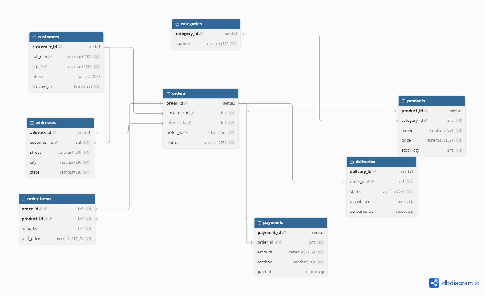

# Portfolio 1: Database Design and Modelling

## Case study
NaijaMart, a simulated online retail platform (see main README).

## ER diagram

## Relational schema
The schema is in `schema.sql` and was loaded into PostgreSQL 16 (database `naijamart`).
Evidence: `tables_created.png` shows all 8 tables created.

| Table | Purpose | Primary key | Foreign keys |
|---|---|---|---|
| customers | Registered shoppers | customer_id | none |
| addresses | Delivery addresses | address_id | customer_id |
| categories | Product groupings | category_id | none |
| products | Items for sale | product_id | category_id |
| orders | An order placed by a customer | order_id | customer_id, address_id |
| order_items | Products inside an order | (order_id, product_id) | order_id, product_id |
| payments | One payment per order | payment_id | order_id (unique) |
| deliveries | One delivery per order | delivery_id | order_id (unique) |

## Constraints used
- NOT NULL on required fields.
- UNIQUE on customer email and category name.
- CHECK: price >= 0, stock_qty >= 0, quantity > 0, and order status limited to a fixed set of values.
- Foreign keys keep every order, item, and payment linked to real parent rows.
- ON DELETE CASCADE on addresses and order_items so child rows are removed with their parent.

## Normalisation
- **1NF:** every column holds one value. No lists or repeating groups.
- **2NF:** order_items has a composite key (order_id, product_id). Quantity and unit_price depend on the whole key, not part of it.
- **3NF:** non-key columns depend only on the key. For example, category names are stored once in categories, not repeated in every product row.

## Design decisions
- unit_price is stored in order_items on purpose. It records the price at the time of purchase, so later price changes do not alter past orders.
- Limitation: city and state are stored together in addresses. City determines state, so a stricter design would split them into separate tables.

## Tests
- I loaded the schema and confirmed the CHECK constraint rejects a negative price
